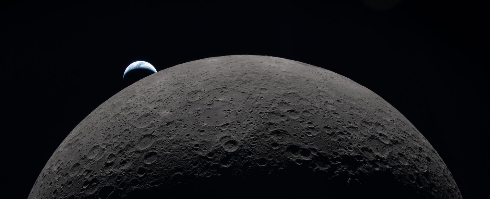
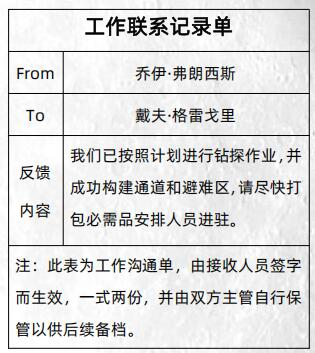
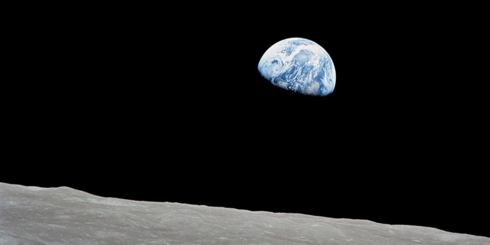
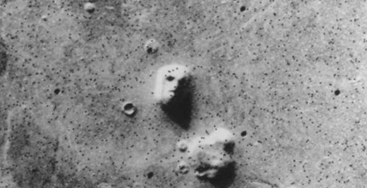
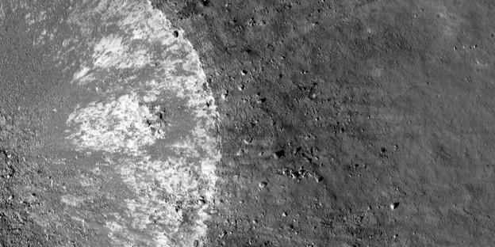

+++
date = '2026-10-13T23:43:25+08:00'
draft = false
title = '月星游记 跑团Log'
tags = ['Life', 'TRPG跑团']
author = [
  { name = "Zed Lee", url = "/" }
]
ShowToc = true
summary = '1870年，随着南北战争的结束，美国费米大炮协会开启了他们疯狂的航空计划——名为探险者号的“炮弹”将搭载甄选出的三名志愿者，完成一场划时代的月球之旅。'
[cover]
image = 'headerImg.jpg'
alt = '月星游记'
source = 'https://www.cnmods.net/web/moduleDetail?keyId=3304'

+++

## 简介

**规则书**

[《命运浓缩版》*FATE Condensed*](https://qm.qq.com/cgi-bin/qm/qr?_wv=1027&k=gtZbhI94sqFSWqL1nCVtZnJ5BwKWNoVz&authKey=QYoRMsb6kNmjMV%2Fa%2B4Fp3m4X7fuZkpzEo8fut96Q8fSM6cBwTcRTxDw5vE7Tawwj&noverify=0&group_code=162792989 '加入QQ群')

**游戏剧本**

[《月星游记》](https://www.cnmods.net/web/moduleDetail?keyId=3304 '前往魔都TRPG下载')（作者：雾翎）

**主持人**

嘻嘻蜥

**玩家**

- Zed Lee 饰 阿丁诺·科波菲尔
- 边沁的猫 饰 费希特·阿尔弗雷德
- 一辉 饰 马龙·马洛

## 故事背景

### 前进，大航海时代

随着无敌舰队的覆灭，伊丽莎白女王完成了她的雄心壮志，自此大不列颠走向了日不落帝国的道路。在一位王爵的倡议下，王室筹建了皇家航空研究会（Royal Voyage Research Association，RVRA），该协会由王室及教会资助，旨在联合各研究所及学院将月球开发成未来的殖民地。

疯狂的工程师们提出了一个划时代的想法，他们建议利用钢铁巨炮，校准定位向月球发射一枚“炮弹航空器”，通过身着潜水服人为在航空器制造真空反应减少冲击，以成功落点月球。这个疯狂的想法在实验所内成为了可能，在动物实验及落点冲击力的计算下，各学科专业人士开始了前期准备，而阻碍成行的核心问题依旧是动力系统。

随着1782年蒸汽机的应用，这一个划时代的发明将航空动力系统发挥到堪称极致的地步。在科学院、基金会、教会、王室、爱好者等的资助及倡导下，欧洲海军将无数舰船进行串连，在大西洋表面构筑了发射基地。

不久后，随着数次试射，最终于1785年成功开展为期十年的发射工程。该次工程累计耗费欧洲大陆五年的工业产值及数不清的化石燃料，将三百名志愿者及数十年的给养与先期设备发射至月球。此计划又被称为“圣伊丽莎白星空计划”。

### 先遣队的遭遇

扣除被砸破脑袋的可怜虫，以及和太空碎石亲密接触的幸运儿，再算上资本家偷工减料的制作工艺造成的爆炸，大约五十名探险者到达了月球表层。

这群探险者很快利用其它落在月面的“炮弹”构建了营地，并很快进行了钻头作业。在此感谢皇家学会艾萨克爵士和那些克服万难的工程师们，探险者对月面进行了勘探作业，经过数十米的钻探，他们探查到[待解密]。而对于他们更令人震撼的发现是，月球中心的浮土层下方，是[待解密]。

然而，在月球之上，[待解密]。人类鲁莽的钻探行为就如同开颅手术一般[待解密]。直到此时，探险者才后知后觉地知道自己即将面临的噩梦——[待解密]。

### 探险者号计划

1870年，随着南北战争的结束，美国费米大炮协会开启了他们的航空计划。在经过近百年的科技发展，基金会及民众捐款的努力下，他们成功将战争武器进行熔铸，构建了以铁路及列车为基础的巨炮基地。这一群疯狂的工程师完全不考虑使用寿命，他们依靠着数学和弹药学理论，火药不够加火药，抗震不够加金属。总之，在联邦的默许下，他们奇迹般地完成了成品，他们骄傲地将特制的“炮弹”命名为探险者号。而玩家们将作为甄选出的志愿者，在完成训练后参与到这个划时代的航空之旅。

## 主要角色

本节将解释这场游戏中的玩家角色与主要非玩家角色。

### 阿丁诺·科波菲尔

- 核心概念：**痴迷阴谋论的科幻小说家**
- 困扰：喜欢断更和虐角色，有时候会被读者寄刀片，想找个清（安）净（全）处
- 关系：费希特·阿尔弗雷德是我的粉丝，我曾经有次被他认出，但因为他是机械师，让我这个科幻小说家燃起了兴趣，结交了一段缘分
- 其他特征：擅长逃跑和伪装，免于被愤怒的读者追杀
- 其他特征：收集癖，喜欢收集罕见的小玩意，不在乎金钱上的价值

**技能**

- 出色（+4）：学术
- 良好（+3）：调查、潜行
- 尚可（+2）：意志、工艺、体格
- 一般（+1）：驾驶、战斗、射击、运动

**特技**

- 科幻作家的积累：因为我是个技艺高超的科幻小说家，为了创作我学习了不少科技相关的知识，所以每当我使用学术分析科技造物时获得+2。
- 公文包里的宝贝：因为我有一个塞满各种奇怪收集品的公文包，所以我可以从中取出一个对当前困境恰好有用的小玩意，但每次场景只能使用一次。

---

### 费希特·阿尔弗雷德

- 核心概念：**追求精密与协调的机械师**
- 困扰：身为机械师，我无法容忍世界的不协调与超常事件，否则我会不停的推断，想要解释为什么会这样子，原理是什么，而思考让我入定也通常会对周围的感知降低
- 关系：我是科波菲儿先生小说的粉丝，但是我也很痛恨他写的刀子
- 其他特征：
- 其他特征：

**技能**

- 出色（+4）：工艺
- 良好（+3）：学术、体格
- 尚可（+2）：
- 一般（+1）：

**特技**

- 因为我右眼带着一枚复合透镜，所以我在维修精细机械或者对细微痕迹进行【调查】或【工艺】时我获得+2加值。

---

### 马龙·马洛

- 核心概念：**身经百战的私家侦探**
- 困扰：对于技术类的东西一窍不通
- 关系：
- 其他特征：
- 其他特征：

**技能**

- 出色（+4）：调查
- 良好（+3）：驾驶
- 尚可（+2）：体格
- 一般（+1）：

**特技**

- 拨开历史的神秘面纱：收到百年前志愿者的后人所托，以发掘真相为目的报名了此次行动。

---

### 迈克·利伯蒂-NPC

- 核心概念：**波士顿志愿工程师**
- 困扰：科学信仰，瞭望员，极强好奇心
- 关系：
- 其他特征：

**技能**

- 出色（+4）：洞察
- 良好（+3）：射击、工艺
- 尚可（+2）：潜行、体格、运动
- 一般（+1）：共情、学识、驾驶

**特技**

- 优秀学员：迈克·利伯蒂在使用航空器材时工艺+2。
- 海员直觉：迈克·利伯蒂在调查地形时可以采用洞察代替调查进行检定。
- 幸运老哥：每游戏一次，可以在一次检定中多投掷两颗命运骰。

---

## FLY ME TO THE MOON

### 升起的炮弹，从下面看？还是从侧面看？




一年的时间稍纵即逝，那些严苛的训练几乎要了你们的命，但终究，你们成为了出色的月球探索者。  
而今天，正是太空船发射的日子！  



“诸位先生和女士们，马上我们的棒小伙子马上就会开始他们的旅程！在此感谢凯特基金会，亚当斯通讯社，还有联邦军事委员会及剑桥科学院的大力支持，今天我们将开始月球之旅！”  



“fly me to the moon……”#偷偷轻哼起来。  



默默听歌和广播。  



看来蒸汽技术的发展与人类对月球的早期探索，让这首曲目提前八十五年问世……考虑到时代背景，也许它的调子与现实世界差异极大。  
而在演讲台上，计划主席正用咆哮般的语气演说着，而你们也早已换上潜水服改制的太空服，在其余工作人员的搀扶下走向太空舱——宛若巨型炮弹般的太空舱。  



“这飞船有点像章鱼，有点像子弹头……”默想。  



除了你们粉丝与作家二人组外，还有一个年轻小伙儿与你们同行。他人叫迈克，迈克·利伯蒂，拥有着出色的洞察能力，但在运动方面的表现只能说尚可。  
他絮絮叨叨地和工作人员们说着什么，表达着自己的激动与不安，而那些工作人员一脸无奈，将他塞进太空舱里。  
随后，他们起身，为你们和搀扶你们的工作人员让开了位置。  



我打量着那些仪器，这些可都是一些精度很高的仪表。  



“科波菲尔，我们所喜爱的科幻小说家，他将化科幻为现实，亲自前往月球寻找当年的遗迹！”  



挥手向大家致意。  



我也开始打量这些仪器，这可是写小说的好素材……  



“费希特，我们最优秀的工程师，他为登月计划出了很大的力，现在更是要亲自前往月球！”  



微笑着挥挥手。  



人群爆发一阵欢呼。  
工作人员等待片刻，随后搀扶你们进入太空舱，然后舱门关闭。  
紧接着，用于缓冲的海水被灌入，计划主席的声音在你们耳中变得沉闷起来。  



不过暂且先将他长篇大论的演讲抛向一边，迈克向你们搭话，“嘿，两位伙计，我们马上就要去月球了，这可真是一项壮举，我可紧张坏了！”  



假装镇定地朝他微笑致意。  



“是啊，不知道宇宙的轨道究竟是如何运转，我的上帝啊，希望月球的暗面不会像小说描写的那样。”  



一本正经道，“能拥有这个机会确实很珍贵，也希望我们能度过一段美好的旅途。”  



举手询问迈克，“你又为何而来”。  



看着海水有些莫名其妙的感觉，“水中月。”  



“我的天！”迈克吓得跳了起来，然后在水中缓缓落下，“老兄，你什么时候上来的！”  
然后他又看向费希特，“我，我吗？那当然是他们给了我一大笔钱，足够治好我老妈的病了！”  



“哈哈哈……嗯……他们也给了我一笔不菲的奖金”我手指请颤看向窗外涌上来的水心中默默祈祷。  



“哦？那祝您的母亲早日康复吧！”  



“谢谢您的祝福，马洛先生。”迈克恢复平静，然后坐在椅子上，开始往自己身上绑固定用的绳子，“他们设计这玩意儿的时候真该用那个叫卡扣的零件……对了，你们还记得我们的任务吗？”  



“活下来。还有别的吗？”  



“原来还有个固定绳！”学着样子开始固定，“是要去调查百年前失事的飞船吧？”  



“您可真会开玩笑，马洛先生。”迈克掰着手指数了起来，固定绳和笨重的潜水服让他的样子看起来有些滑稽，“回收圣伊丽莎白星空计划的可靠记录、收集月球物质、带回前驱者的遗物……大概就这三项。”  



“嗯，那还是活下来比较重要。”  

 <工作人员> 环×3  
沉闷敲击声响起，观察窗外有工作人员在提醒你们，“开拓者们，你们固定好了吗，我们要准备发射了！”  



“还有宣传美国先进。”我用那套着壳子滑稽的手指出来，听见门外的声音我也急忙固定好绳子。  



检查检查。  



抽了抽绳，感觉还算牢固。  



思考水的作用中。  



朝工作人员比了个ok的手势；  



工作人员点点头，转身离开，不一会儿，你们就听到计划主席大喊：“探险者号，探险者号向您致敬，我们即将去为露娜小姐献上鲜花。伙计们，旅途即将开始。哦上帝，对了我得先找个掩体看看……老汤姆，去点火！”  



他从六十秒开始倒数，你们感觉屁股下的椅子和周遭海水一震，炮弹太空舱开始缓缓移动，填充至大炮发射台之中。  



“这老汤姆是懂得折磨人的。想想看死刑犯被押上刑场之后发现要倒数六十秒。”  



当倒数归零，世界仿佛静止一瞬，然后巨大的力道从你们屁股传来。  
你们的身体承受了巨大的压力，曾经几乎要了你们命的训练如今保住了你们的命，你们痛苦不已，但还活着。  




### 地月之间




透过舷窗，你们可以看到红色的火光，好在炮……太空舱足够厚实，浸泡你们的海水依旧冰凉。  
地球距离你们越来越远，当你们彻底适应现在的状态后，你们已经身处星空之中……  



手指在椅子扶手上敲出马蹄声，哒哒哒哒，哒哒哒哒。  



“这就是太空吗？终于亲眼见了啊……”咳咳，“我这段经历直接秒杀所有同行……”  
看向窗外，我们离月球还有多远？  



阿丁诺，这个问题不太好回答，虽然作为科幻小说家的你，数学和物理学的基础打得很牢固，但地月航行这事实在难以以感觉判断。  
不过根据这项计划的工程师们的计算，你们抵达月球大约要两天时间。  



还有两天吗！不会抵达之前都要一波三折吧？  



“真是糟糕的体验”我望向窗外，星河璀璨，蓝色星球赫然眼前，我愣住了，没想到地球原来真的是圆的，涨了张嘴，“那个你们不觉得宇宙这么大，而我们渺小如一粒尘埃吗？”  



“我们是会思考的尘埃，会探索的尘埃！”  



“如果你能把你的思考变成书，而不是脑子里的东西，你一定比现在还富有。”  



“我显然已经有了很多的书，只是我的笔总是没墨。”目移。  
 <马龙·马洛> 环×3  
“巧妙的比喻，我的朋友。”我在想这个时代都上天了应该知道地圆说啥的了吧，科技树应该是这么点的不是吗？  



“并非比喻呢……”心想，但无所谓了，开始观察起飞船内部的设施，看看控制器在哪里。  



望着外面，地球星河中旋转，我陷入了思考，牛顿说的是真的，这个宇宙如此精细，为什么会如此。  
我摇了摇头，抽回思绪，想要看看内部都有什么设施。  



虽然太空舱很大，但操纵它的只是一根小小的控制杆，它的航行轨迹已经经过计算，不出意外的话会让你们抵达百年前圣伊丽莎白计划的登月点附近。  
操纵杆的作用是让太空舱释放事先存储的蒸汽燃料，对航行轨迹进行微调，避开可能存在的陨石等太空物质。  



只靠操纵杆就可以做成这样子，嗯总有一天我要把他拆开看一看。  



除此之外，这里还有三个被焊死的箱子，里面分别装着备用氧气罐、水袋和食物袋，这将是你们未来96小时的口粮——开玩笑的，只能维持两天，剩下的物资会用其他炮弹送到月球。  



坐会原位，“好无聊啊，我们玩一场RPG吧……”  



“嗯。”  



“在太空中方便投骰子吗？”  

 <费希特> 环×3  
“或许我们可以用扑克牌代替……”最后抽出几张扑克。  



“抓阄。”  



那么时间飞速流逝……  




### 撞击危机




当你们从睡眠中苏醒，看着潜水服内嵌表盘上的时间，意识到距离月球还有约半天的时间。  
而场外的景象大变样。星空还是那片星空，但此时此刻漂浮着许许多多的陨石，你们觉得自己很可能是第一批如此近距离欣赏漂浮在太空中的陨石的人类——你们错了。  
在漂浮的陨石带之间，混杂着一些老式大号炮弹，它们大多严重变形，有的炮弹舱门被挤开，一些先遣者的一部分挂在炮弹里，另一部分则飘在太空中，像舞者般飘动，又好像在挥手欢迎你们  
你们对此等情景并没有足够的心理预期，费希特在慌乱之下不小心碰到了操纵杆，太空舱的方向微微偏转，眼看着就要冲入陨石更加密集的区域。  
这是一次针对费希特困扰的驱使，你可以支付一枚命运点拒绝，或者接受这次驱使，并获得一枚命运点。  



我接受这次驱使，面对突发情况我根本无办法推理眼下的情况，变得手忙脚乱。  



“我的天呐！我的天呐！我的天呐！”突然发出叫声的迈克吓了你们一跳，他指向另一扇舷窗，一颗炮弹残骸正在靠近你们，“我们要撞上了！”  



转头向众人喊道，“谁会驾驶？快去控制方向！”  



“我会驾驶！”迈克举起手，而阿丁诺知道，他的架势技术和自己一样，相当一般。  



什么嘛……原来自己比想象中还冷静啊。毕竟我可不想就这么死掉。  



马龙，如果你还没点技能，现在正是点一下的好时候，想通过控制杆避开残骸的难度是4。  



我看着这种情况，只能暂时放空大脑相信别人。  



摊。  



思考……驾驶这种东西点个+3还是点个+2，还是必须+4才够用？  
侦探的话肯定调查还是第一位，所以+4应该给调查，感觉驾驶最多吃一个+3。  



0+--+3（驾驶）=+2（尚可），失败  



我是哪来的大眉笔！  



你可以用命运点。  



命运点可以干啥呢？  



如果存在可以帮到这次检定的特征，就可以激活它，选择重新掷骰或者+2。  



或者使用你的特技！  



我一个侦探怎么可能有开车的特技？除非我口胡一下，说我非常冷静，临危不惧这一块，但是这样的特技不是太宽泛了吗？  



那个时代好像侦探都是干黑活的。  



这个时代都有福尔摩斯了吧，那我觉得也没啥黑活不黑活的。  



无所谓，只要让你的角色足够积极主动、能力过人且充满戏剧性即可。  



因为我是侦探，所以经常遇到艰难急险的情况。越是在这种紧迫情况反而越是冷静行动迅速，这是成为侦探的必须条件，然后烧一个命运点，+2。  



我忘了你的核心概念是什么了，你在此补上吧！  



我也忘了，加个定语来，解决问题的侦探，困扰是无逻辑的事物几乎无法理解。  



实在不行咱传统点，身经百战的私家侦探？  



OK！  



OK，那么+2之后达到了出色（+4），为平局。  
在你临危不乱地驾驶之下，太空舱顺利地避开了那些陨石。  



“我的天呐！刚刚可真危险！”迈克一阵后怕，“尤其是那些运动状态的陨石，速度真快——马洛先生，你以前一定打过移动靶！”  



喘了一口气，想去数窗外的炮弹数量。  



他话音刚落，迈克口中那些“运动状态的陨石”就证明了自己的危险性，你们感到剧烈震动，显然有东西以相当快的速度撞上了太空舱。  
撞击位置与你们前进方向相反，这让太空舱的速度陡然提升。  



习惯性的扶额，继续尝试维持驾驶姿态。  



虽然迟到行为令人恼火，但不是所有事情都适合提前，比如登月  
现在太空舱以比计划中更快的速度冲向月球，你们得有所行动了！  



“那个，你们喜欢吃，小肉饼吗？”  



迈克迅速收集你们之前吃剩的袋子，将它们塞进箱子并将箱子锁好，然后坐回座位，开始往身上缠固定绳，“我的天呐！伙计们，我们即将承受巨大的冲击！”  



跟着一起缠固定绳，保命要紧。  



继续尽可能调整，当然，一个炮弹能有什么姿态呢？感觉无论如何都是难逃坠机的命运。  



“有办法减速吗？”  



我紧紧抓住一旁的栏杆，抵抗着下坠的速度，我明白在天空中这种下坠速度没有任何仪器能阻挡，“我不想变成小肉饼啊。”  



“让我看看？”  



马洛，你对速度和距离敏感吗？  
如果你有一个代表对速度和距离敏感性的特征，你就可以判断你们还有多长时间可以抵达月球。  



观察着参考物加速度和重量，我试图判断还有多少时间够我们行动。  



我感觉不敏感，因为我毕竟是个侦探，这种东西不应该是我能知道的——我又不是运动员。  



你可以和犯人有过飙车戏码。  



这个年代的车需要飙吗？飙也是马车吧？马车的话，我也应该是骑马的吧？  



蒸汽汽车！你可以骑着马追蒸汽汽车……很有氛围——不过这段剧情过去了。  



回想自己学过的物理知识，通过月球大小的变化速度判断一下当前的行进速度。  



阿丁诺，虽然在炮弹刚刚发射时你难以判断，但现在月球的近景已经映入你们的眼帘，而且还在缓缓变大，你能确认还有不到半小时，你们就将完成登月壮举。  
而费希特也有自己的发现，迈克提到的“巨大的冲击”不幸言中，因为不仅炮弹被陨石还是什么别的太空物质加了速，而且舱体出现了微小裂痕，用于缓冲的海水正在泄露。  



“我们可以把那个操作杆下的挡板拆开，我或许可以看一下，死马当活马医吧！”  



我觉得这是一次挑战！所谓挑战，就是在一个场景中，为了达成某一目的，你们需要完成多次行动。  
费希特想办法堵住裂缝，这需要通过难度为3的工艺；以及，如果想让太空舱减速的话，也需要难度为3的驾驶；以及……通过难度为3的学术，可以帮你们找到最合适的应对冲击的方案。  



“迈克老兄，来搭把手！”  



-+-0+3（驾驶）+1（迈克·利伯蒂的协助）  
=+3（良好），平局  



开始掏自己随身携带的公文包，看看能不能找到胶带或者别的什么能堵住裂痕的东西。（公文包里的宝贝）  
找到了一个前几天搜集的市面上新款的特级胶带，并用它堵上了裂缝。  



+0-++2（工艺）=+3（良好），平局  



其实这可以让你不检定直接成功。  



看到基本裂缝的问题基本解决后，开始思考，“我们得想想接下来的应对策略……”  



然后，费希特，你要负责寻找应对冲击的方案吗？  



我沉下心来思考寻找减速的方式……那我给我的学术点+3吧。我开始观察各个细节，整个飞船的架构并用玩所掌握的学术知识推演。  



+++++3（学术）=+7（史诗），大成功  



虽然漏出了部分海水，但太空舱冲向月球的速度得到了遏制，同时费希特计算出应对冲击最合适的位置并非座椅，而是一个箱子附近……剩余的时间足够你们完成固定了！  



听到费希特的结论，赶忙带着绳子去到箱子处固定好自己。  



“保佑！”我也去箱子处绑好自己。  




### 当第一枚炮弹落下




斑驳的暗白色岩层在舷窗里快速接近，最终来了一次亲密接触，紧接着舷窗破碎，太空舱也开始翻滚。  
你们觉得脑子被摇匀了，但承受的冲击程度完全在意料之内，某种意义上甚至比你们在太空舱发射时的冲击还要低一些。  
总之，在你们的眩晕减弱之后，你们发现太空舱已经停下来了。  



“咳咳，他们会派艘新的来接我们回去吧……”稍稍稳住身形，询问众人情况，“你们怎么样，还醒着吗？”  



“呼呼…”我深呼出一口气，虽然不知道之后还怎么样，但至少现在活下来了，“我还好其他人呢？”  



“坏了。”  



你们注意到一件事，同伴的说话声音小了许多。声音不是从他们的嘴传来的，是从你们身下的地板和残存的海水传来的。  



“马洛，阿丁诺，迈克？”  



太空中缺少传导声音的介质……”  



迈克从潜水服的腰间拉出两根橡皮管，递给阿丁诺和费希特，示意你们把它固定在你们腰间。  



挥了挥手，比了ok的手势，然后接过橡皮管固定在腰间，心想，“这是通讯的装置还是……？”  



拿过橡皮管，固定在腰间，我站起身来观察飞船怎么样了。  



迈克打开一个小阀门，“嗨喽嗨咯，听得到吗听得到吗？”  
虽然声音还是挺奇怪的，但至少能听清了。  



“果然不出我所料~”听到声音后心想。  
“能听到！”回应道，“真是奇妙的体验……虽然有些狼狈。”  



“嗯……有点怪异，这种东西。”  



哦对了，有个好消息和一个坏消息，你们想先听哪一个？  



坏消息？  



坏消息是，你们的潜水服没有钢铁侠战甲那样的过滤系统。  
好消息是，潜水服经过设计，排泄物可以直接排泄——不过考虑到密闭技术，时间久了味道还是会漏。  
以及，感谢费希特的计算吧，要是冲击再严重些，让你们吐在头盔里，可没办法摘下来清洗。  
总而言之，开始你们的行动吧！  



哇，太好了我将会是第一个在月球上大便的人，这一小步是人类文明的一大步！  
——我想看看飞船有那些遗漏的零件齿轮，小一些的我会收集进包里。  



四处打量，确定我们的位置离目的地的距离。  



阿丁诺爬出太空舱，你看到太空舱在月面留下的痕迹明显比别的地方更深，但也逐渐恢复成暗白色  
目之所见倒是看不出目的地的位置，但费希特之前计算时已经大概算出了你们的着陆点，这让你们知晓方向。  
哦，有个好消息忘记告诉你们了，你们确定你们的前辈有不少成功抵达月球，因为你们在迫降时看到了营地的痕迹。  



“月壤还会变色？是因为摩擦产热的原因吗……对了，我们是不是得收集一点月壤？”  
拿出密封袋，搜集了一点月壤放到公文包里。  



“嗯，你们听说过这么多前辈吗？”  



“似乎是在文档中有记载。”  



“他们还活着吗？但愿他们还活着！”  



以及有个坏消息，由于你们的提前降落，与你们配套的补给炮弹还未抵达月球——由于之前的混乱让你们损失了一些备用氧气罐，所以你们剩下的氧气不太充裕。  



我捡起来了地上散落的小齿轮和一些发条指针之类的部件，我发现因为失去压力很对东西都已经失效了，指针在到处摆，回过头我看向大家，“总之我们也没有地方可以去了，物资不知道还能不能撑到救援……或许活过着一周都很难。”  



“按照之前说好的，我们得在月面待上两天，然后会有接引我们的炮弹抵达。”迈克一边念叨一边看着周围，显得有些懵。  
然后他突然大叫起来，“我的天呐！我的天呐！是月球，真正的月球！”  
“这可太让人激动了，我一定要和老妈好好讲讲我现在看到的！”  



“那看来只能去前面的营地看看有没有……”被迈克的惊叫声打断。  



大喊大叫结束后，他看向你们，“你们不兴奋吗……哦我的天呐！你们比我聪明太多，这样喊会浪费氧气！”  



“……氧气罐了。”  



“唉，还好有你们，不然我得犯傻到什么时候。”说完，他闭上了嘴。  



“这上面没有怪物，也没有生物，月球……我感觉好荒凉。”  



不再说话，只是点点头。  



点点头。  



减少说话，用手势示意大家去营地的方向看看。  



那么确定接下来前往营地？很好，我们接下来……  




## 漫步月面之上

### 探索先遣者营地




你们在过去一年接受的严苛训练没能让你们立刻适应月球重力，为了交流而连接彼此的橡皮管也影响你们的行动能力。总而言之，在约一小时后，你们抵达了一处月表高地。  
你们看到了广袤而荒芜的月面，其上坑坑洼洼。  
而在不远处，是百年前的志愿者们留下的营地。  
说是营地，但其实相当简陋，它依托月表的特殊地形而建。  
炮弹发射藏与月岩围绕着营地，构成简易的防御工事，营地内部则是由防水布与熟牛皮构成的帐篷，不过具体细节得亲自过去才能看到了。  
阿丁诺，你的物理学知识告诉你，营地外围那圈结构能够抵挡强风。  
马龙，你作为侦探的敏锐让你立刻意识到一个问题——为什么要在月球上搭建防御工事？  



望过去，“好庞大的营地啊！”  



“营地外围的结构似乎是个防风装置……”有些疑惑，“不过月球上会有大风吗？”  



“不清楚，应该不会有吧？”  



补充一句，你们感受不到任何风。  



“我们现在是直接走过去搜物资吗……还是先在外面观察一下？”  



“我想我们直接进去看看，你们觉得如何？”  



“大侦探，有看出什么吗？”侧身向马龙。  



尝试检查。  



费希特，作为团队里的机械师与工程师，我认为你应该比较关注你们设备的情况——这意味着你发现你们的氧气已经相当不足了，而运送物资的炮弹迟迟没有抵达月表。  



“三位，有没有人曾经说过，在月亮上有什么，活物之类的？”用手指了指类似战壕的设施。  



“月球上的怪物？外星人的基地？还是……”回想自己道听途说过的阴谋论。  



“看起来是的月球暗面是真的？不过我们的氧气已经即将供应不足，炮弹现在还没有到来，或许我们应该去营地看看。”  



向费希特点点头，“确实，也没办法了。”  



看了看工程师和小说家，无奈的挠了挠头，当然摸不到，“还是我一个人先去探探路吧！”  



“我们用传声器连着的，没法单独行动。而且单独行动太过危险，有突发状况我们也难以联络。”  



“刚才飞船上那两下子……你们俩不添乱就算好的。”  



“一键查询是谁补好了裂缝。”  



“好吧好吧……注意安全。”  



“好了再说下去氧气要耗尽了，那我们走吧！”迈步前往。  



一同前进。  



来到营地后，你们注意到了更多细节，比如外面的围挡以及帐篷间的空隙都有人为缩减的痕迹。马龙在处理一起与猎户有关的案子时见过类似的手段，被用于抵挡狼群的袭击。  
费希特在营地中找到了一些工具，其中比较多的是拼装式工铲，上面有着许多划痕和暗红色泥土，可以看出使用频率不低。  
阿丁诺则是在一处篷布的下方发现了约半米的坑洞，看起来是人为挖掘的，里面有着一些未启用的氧气罐和罐头。  



摸摸帐篷，看看有没有问题。  



篷布厚实，熟牛皮结实，看起来百年前的圣伊丽莎白星空计划的贪腐问题没有这次那么严重——不过它们无一例外地严重褪色。  



“这铲子看来没少用，他们挖这些洞和泥土是为了保温吗？”  



“很有可能，有什么好消息吗？”  



“太好了，找到氧气罐了！”朝众人示意，“还有些罐头！”  



第一件事，好消息，费米大炮协会的赞助者们曾高价购买过圣伊丽莎白星空计划的资料，并以此为参考设计了你们现有的装备——这意味着你们可以直接使用百年前的氧气罐。  



“真是个好消息，多亏了上个世纪就已经研究出了很好的保鲜技术。”我拿起一盒罐头查看上面的文字。  



第二件事，坏消息，你们找不到合适的方式来吃罐头食品，你们的食物都是袋装，通过专门的进食软管食用——至少饿一会儿不会出什么事儿。  
而费希特……这些罐头的包装极其朴素，既没有生产日期也没有配料表，仅仅有“牛肉罐头”“水果罐头”这样的品类名，以及赞助商的商标。  



“那么……人呢？”观察营地，想看有没有其他人留下的痕迹……新鲜的。  



最后，马龙，你不愧是个侦探，你意识到了不存在的事物反而能成为线索——假如这是个营地，那人都去哪了？  
毕竟过了快一百年，没有活人才是正常情况——但死人去哪了？  
整个营地里能看到最接近人形的物件，是几个头盔玻璃碎掉的潜水服，而里面空空如也，并没有尸体。  
嗯……马龙，你可以尝试调查一下，难度为2。  



“人会去那呢？这不正常至少不合理，没有理由啊月球空荡荡的不会有资源，除非有什么东西来了。”  



0+00+4（掉还差）=+5（杰出），大成功  



大成功！Success with style！  
首先，月球上大概确实没有风，因为哪怕经过百年，地上的一些痕迹也没有被消磨，你通过那些杂乱的脚印和阿丁诺发现的那些物资的散落状况，推断出营地的人曾经有组织地撤离。  
其次，在营地的外围，你又发现了一个空空的潜水服，但这个潜水服的手上攥着一张纸。  



凑近看看。  



得益于潜水服的保护，它上面的文字虽然也有褪色情况，但并不严重——这是一张表单。  

你也注意到那些离开的脚印前往的方向，那里大概通向纸张上记录的地点。  
然后，算是这次调查的额外收获，你已经对当前营地的地形了如指掌（可免费激活一次）。  



回忆之前的调查情况，探月计划里出现过这两个名字否。  



好问题，考虑到你是个侦探，对名字可能比较敏感，你记得这两个名字在圣伊丽莎白星空计划志愿者名单中出现过，是三百个志愿者之一  
同时圣伊丽莎白计划确实有送到月球相当多的工具与设备，以至于当初的志愿者们可以在月球组装出用于钻探的设备。  




### 请问要来点兔子吗？




啊，费希特，我记得你眼神还不错？  
你看到附近有个东西在动，那东西迅速移动到一块月岩的后面。  



“那里有东西！”我举起手指向那块月岩。  



迅速看过去。  



月岩后面探出什么东西，那东西在动，但不靠近的话是无法确认那个东西是什么。  



“嘘。”  



倒也不用刻意噤声，只要不用力跺脚，你们发出的声音是不会被月表的其他人听到的——哦，前提是月表有其他人。  



“我过去看看”我决定往前移动。  



跟在后面，慢慢向那个位置移动。  



其他人怎么想，有人要断开链接吗？  



小心翼翼把纸收纳起来，继续殿后  



那然后我到了岩石面前，头往后面探。  



你们看到了……一只小白兔，有富人家猎犬那么大的小白兔。毛色偏暗，像是月球岩石的小白兔。  



警惕，“月球上会有兔子吗？”  



它不逃不躲，就那样呆呆地看着你们，还挺可爱的。  



心中不禁想起一些恐怖的设定，比如什么外形变形怪伪装成兔子。  



“这是兔子吗？”我后退了两步。  



后退两步。  



比较兔子和帐篷战壕的高度，特别是缝隙减少部分的高度。  



敏锐的侦探！无论这些兔子有没有攻击力，无论营地的调整是否是因为这些兔子，但如果这种兔子对营地发生攻击，人类确实能借助这些调整来抵御它们。  



试着冲它招了招手。  



面对费希特的试探，那兔子竟真的靠近，用额头顶了顶你的手——隔着潜水服，你摸不出毛茸茸的手感，但你能大概感觉到，这玩意儿头盖骨可能挺硬。  
暂且来看，这玩意还是比较友善的——就在你这么想的时候，它一脚将你踹翻，朝着边上跑了一段。  



“头盔也许就是这么破的。”  



“？？？”看着跑远的兔子，“至少这是个动物。”  



“为什么这里的动物会那么大呢？这不和常理啊……”  



“显然更不合理的是没有氧气居然有兔子这件事吧……”  



“首先要确认的是，嗯……你们刚才有没有注意它有没有在呼吸？”  



兔子没有跑太远，在间隔你们约五十米距离时，它停下来，继续呆坐着看着你们——然后你们注意到，在它身后，不知什么时候又冒出几只兔子，而且一样呆坐着看着你们。  



“唔……好多兔子……我一定是在做梦，我在飞船上睡着了还没醒来。”掐自己胳膊。  



“嗯……我建议咱们慎重一点。我的意思是说，快跑……”  



“万一他们有狩猎本能呢，话说兔子应该不会有，但是这个不像是一般兔子，我们先退回帐篷吧。”  



“笨蛋……快跑也是，有序撤退。”  



“跑！”  



我确认一下你们三人的意见，你们要跑，但是往哪跑？营地内部吗？  



我往帐篷跑回去。  



朝帐篷跑去。  



每一个营地的帐篷，都做了小缝吗？  



小缝？指的什么意思？你是说应对入侵的措施？不是在帐篷上，是帐篷与帐篷之间留下的过道等。  
营地帐篷有很多，毕竟曾经住过三百号人。你们躲了进去，而有着和猎户合作经验的马龙意识到，这种行为就好像缩壳乌龟，无法实质解决危险  



“先分析一下情况？当然我感觉这里的事情都超出常理。”  



是的，所以你很难分析出来什么，因为眼下的情况难以找出逻辑——这是一次驱使，你接受吗？  



感觉没有不接受的道理，但是有什么代价？  



代价就是你现在想不出东西。  



先接受吧。  



“我们能在这些帐篷里搜搜有没有资料吗？”  



没有资料，很干净，按照马龙之前的说法，这些资料大概在撤离时被转移了。  



“我说，我摆烂了，太诡异了。”  




### 天上也会掉补给




就在你们不知所措时，你们感受到地面在颤动  



“怎么回事？”努力稳住身体。  



我身体摇晃，探头望了外面一眼，“这说地震了，等一下月球怎么会地震呢……”  



费希特可以看到从地球方向来了几枚炮弹，落在营地不远处。  
而那些兔子不知道什么时候又多了十多只，两三只一组，两组盯着你们，其余几组跑向那些炮弹的落点。  



看看自己的身上，有没有类似狗牌之类的，可以证明自己身份的物品？  



有的，你们每个人脖子位置都有刻有你们名字的黄铜铭牌。  



“啊，是导弹雨来了”我震惊的看着那些兔子，“他们好像要抢我们的物资！”  



“看来我们似乎不得不解决这些兔子了……”  



“没办法的事，那个。我想先去确认一下刚才给我们留下信的那个人到底是谁。我的意思是，这个东西。”  



“有道理，或许可以试试看能不能用罐头引开它们。”尝试拿出一个罐头在兔子们面前晃动，顺便观察兔子的反应。  



兔子呆呆地看着你，这次没像之前那只一样靠近了。  



打开一个罐头，朝远处扔去，看看能不能引开兔子。  



而阿丁诺的罐头确实吸引了一组兔子，它们以一种狗吃食的方式啃食起罐头——你发现它们好像连罐头都啃掉了。  



在去回收物资的路上，顺便看一下那个攥着纸的人到底是谁  



马龙，你现在没法去回收物资，除非中断与队友的链接或者拉着两位队友一起。  



我站在远处仔细观察那些炮弹的形状形态。  



这些炮弹毫无疑问就是装着你们未来月面两天，月地之间两天的物资的炮弹。  



“所以说。没有武器，对面数量也比我们更多。如果我们不去拿东西的话就会饿死。是这样的情况对吗？”  



“额，有再多罐头看起来也不够了，我们不可能打赢那些兔子，这些兔子应该暂时打不开那些炮弹，毕竟他们没有手，或许我们可以去营地内部看看有没有趁手的武器？”  



“我想不用多久，你觉得炮弹外科会比罐头皮坚固多少？”  



“我们几个真的能和这些兔子正面战斗吗？”  



“工程师，弄个类似磁铁一类的东西，把这些炮弹调回来呢？”  



“我现在手上的材料只有齿轮和零件，对了还有这把铲子，目前看来只能去营地里看看了，你们觉得呢？”  



其实炮弹外壳还是比罐头皮结实许多的，都是金属不代表是同一种金属，罐头皮的厚度属于你们大点力气也能勉强撕开的程度。  
以及那些兔子比起想要物资，更像是在观察，只要你们不刺激它们，它们基本呆坐在那，盯着你们或炮弹。  



“看起来，这些兔子还没有要攻击我们的意思。”  



那我能不能先去看看那个人叫什么名？  



哪个人？  



是那个攥纸的尸体吗？  



是啊。  



那具尸体……不是，没有尸体，那套潜水服上没有身份铭牌。你们发现的全部潜水服都没有身份铭牌。  
一个可能的原因是，当初那批人，是有可替换潜水服的，因此身份铭牌没有放在潜水服上。  



“嘶，如果没有风的话，应该不会有什么风化？”  



“这些兔子会吃金属，会不会是这些兔子把黄铜铭牌吃掉了？”  



“我觉得更像是把金属咬开，而不是吃金属。”  



“月球上都有兔子了，会吃金属也不奇怪”摊手。  



潜水服上也有许多金属，比如头盔，这些地方都是完好的。  



“走吧，我们继续。可能我只想希望获得一些，逻辑性的东西。”  



“这个地方唯一的逻辑就是没有逻辑，我的上帝啊，我快疯了，一切兜显得那么诡异怪诞，只能走一步看一步了。”  



“我没想到你比我还不能接受现实。”  



找找百年前的足迹，“继续往哪前进呢？”  
转向众人，“深入营地，还是去找我们的补给？”  



“嗯，深入营地吧，我感觉不像是人们在迁徙而像是集体消失了一样，为什么这里会留下纸条，是走的胎匆忙吗？或许营地内部会有更多的资料。”  
“马洛先生，你们觉得呢？”  



“现在我们，先拿两个罐头，然后搜索一下吧。”  



“避难区……”拿起之前发现的纸，“如果我们要继续找那些前人的结局，可能得跟上这些撤离的足迹。”  



是回到你们已经搜索得差不多的营地，还是前往纸条提到的避难区，还是去刚刚落下的补给炮弹里去拿补给？  



“感觉营地依旧搜得差不多了……或许我们得二选一了，避难区还是补给炮弹？”  



“然后咱们被兔子打死吗？”  



“嗯…看来我们应该去避难区了，事不宜迟我们走吧，带好物资。”  



“走吧。”  



我也起身拿起几个罐头，按照大家的线索的指引前往目的地。  



思考着可能性，维持着殿后。  



没有去拿属于你们的物资？OK……  
那么，你们抵达了——钻探营地！  




## 月星深处的恐怖

### 钻探营地




就在你们不知所措时，你们感受到地面在颤动  



“怎么回事？”努力稳住身体。  



我身体摇晃，探头望了外面一眼，“这说地震了，等一下月球怎么会地震呢……”  



费希特可以看到从地球方向来了几枚炮弹，落在营地不远处。  
而那些兔子不知道什么时候又多了十多只，两三只一组，两组盯着你们，其余几组跑向那些炮弹的落点。  



看看自己的身上，有没有类似狗牌之类的，可以证明自己身份的物品？  



有的，你们每个人脖子位置都有刻有你们名字的黄铜铭牌。  



“啊，是导弹雨来了”我震惊的看着那些兔子，“他们好像要抢我们的物资！”  



“看来我们似乎不得不解决这些兔子了……”  



“没办法的事，那个。我想先去确认一下刚才给我们留下信的那个人到底是谁。我的意思是，这个东西。”  



“有道理，或许可以试试看能不能用罐头引开它们。”尝试拿出一个罐头在兔子们面前晃动，顺便观察兔子的反应。  



兔子呆呆地看着你，这次没像之前那只一样靠近了。  



打开一个罐头，朝远处扔去，看看能不能引开兔子。  



而阿丁诺的罐头确实吸引了一组兔子，它们以一种狗吃食的方式啃食起罐头——你发现它们好像连罐头都啃掉了。  



在去回收物资的路上，顺便看一下那个攥着纸的人到底是谁  



马龙，你现在没法去回收物资，除非中断与队友的链接或者拉着两位队友一起。  



我站在远处仔细观察那些炮弹的形状形态。  



这些炮弹毫无疑问就是装着你们未来月面两天，月地之间两天的物资的炮弹。  



“所以说。没有武器，对面数量也比我们更多。如果我们不去拿东西的话就会饿死。是这样的情况对吗？”  



“额，有再多罐头看起来也不够了，我们不可能打赢那些兔子，这些兔子应该暂时打不开那些炮弹，毕竟他们没有手，或许我们可以去营地内部看看有没有趁手的武器？”  



“我想不用多久，你觉得炮弹外科会比罐头皮坚固多少？”  



“我们几个真的能和这些兔子正面战斗吗？”  



“工程师，弄个类似磁铁一类的东西，把这些炮弹调回来呢？”  



“我现在手上的材料只有齿轮和零件，对了还有这把铲子，目前看来只能去营地里看看了，你们觉得呢？”  



其实炮弹外壳还是比罐头皮结实许多的，都是金属不代表是同一种金属，罐头皮的厚度属于你们大点力气也能勉强撕开的程度。  
以及那些兔子比起想要物资，更像是在观察，只要你们不刺激它们，它们基本呆坐在那，盯着你们或炮弹。  



“看起来，这些兔子还没有要攻击我们的意思。”  



那我能不能先去看看那个人叫什么名？  



哪个人？  



是那个攥纸的尸体吗？  



是啊。  



那具尸体……不是，没有尸体，那套潜水服上没有身份铭牌。你们发现的全部潜水服都没有身份铭牌。  
一个可能的原因是，当初那批人，是有可替换潜水服的，因此身份铭牌没有放在潜水服上。  



“嘶，如果没有风的话，应该不会有什么风化？”  



“这些兔子会吃金属，会不会是这些兔子把黄铜铭牌吃掉了？”  



“我觉得更像是把金属咬开，而不是吃金属。”  



“月球上都有兔子了，会吃金属也不奇怪”摊手。  



潜水服上也有许多金属，比如头盔，这些地方都是完好的。  



“走吧，我们继续。可能我只想希望获得一些，逻辑性的东西。”  



“这个地方唯一的逻辑就是没有逻辑，我的上帝啊，我快疯了，一切兜显得那么诡异怪诞，只能走一步看一步了。”  



“我没想到你比我还不能接受现实。”  



找找百年前的足迹，“继续往哪前进呢？”  
转向众人，“深入营地，还是去找我们的补给？”  



“嗯，深入营地吧，我感觉不像是人们在迁徙而像是集体消失了一样，为什么这里会留下纸条，是走的胎匆忙吗？或许营地内部会有更多的资料。”  
“马洛先生，你们觉得呢？”  



“现在我们，先拿两个罐头，然后搜索一下吧。”  



“避难区……”拿起之前发现的纸，“如果我们要继续找那些前人的结局，可能得跟上这些撤离的足迹。”  



是回到你们已经搜索得差不多的营地，还是前往纸条提到的避难区，还是去刚刚落下的补给炮弹里去拿补给？  



“感觉营地依旧搜得差不多了……或许我们得二选一了，避难区还是补给炮弹？”  



“然后咱们被兔子打死吗？”  



“嗯…看来我们应该去避难区了，事不宜迟我们走吧，带好物资。”  



“走吧。”  



我也起身拿起几个罐头，按照大家的线索的指引前往目的地。  



思考着可能性，维持着殿后。  



没有去拿属于你们的物资？OK……  
那么，你们抵达了——钻探营地！<主持人> 环×3  
在你们前往钻探营地的过程中，那些月球大兔子一直在追逐你们，好在它们总是会和你们保持一定距离，不然一只兔子一脚也够你们受的了。  
而现在，你们抵达了钻探营地。  
这里要比刚刚用于居住的营地小了不少，而且只有三三两两的帐篷，更多的是一些机械设备。  
身为机械师的费希特可以看出这些设备大多是临时搭接，一些需要组装的地方都是以相当暴力的手段，用金属片等方式强行接在一起的。  



四处看看这里有没有什么人类的遗体。  



乍看之下没看到什么人形存在，但这里有其他值得注意的地方——这里有爆炸痕迹。准确的说，是使用炸药进行爆破的痕迹。  
阿丁诺，作为一个科幻小说家，你应该知道如果没有氧气，黑火药基本无法被引爆。  



“早知道这些东西会跟上来，还不如去拼一刀。”  



“难道说这里曾有过氧气？”暗自思忖，“还是他们用了别的炸药？”  



“到了这里应该能够找到这些事情的原因了。”我蹲下来查看那些机械。  



经过费希特的检查，这些机械设备的作用也被你们解明——钻探设备。它们以多台蒸汽机作为动力系统，通过特制管道进行串联，并最终接入一台大型钻头。  
大型钻头下是个深坑，但如今被破碎的月岩掩埋。  



“‘月球有氧气’和‘存在不需要氧气就能爆炸的炸药’这两件事都很离谱啊……”  



马龙，你发现了点独特的物件，在营地稍远处，有辆蒸汽车，它就静静地停在那里。  



我尝试查看这些设备是否还可以使用。  



百年时间为这些机器增添了些许未知的故障，但经过简单检查后，你有信心将它们修好——虽然在月球上钻探听起来很不可思议，但这些机器并不算多么精密，主打一个力大砖飞。  
然而有个棘手的问题很难解决——没有燃料。  
就算把机器修好，那几台没有燃料的蒸汽机也无法将钻探设备重新启动。  



“这台机械的能量已经耗尽了，看起来已经很久没有人使用了。”  



“兔子都能存在的地方，发生什么事都不需要意外吧？”目光看着蒸汽车，走上去检查有没有做过什么改造之类的。  



马龙这边，你来到蒸汽动力的车辆旁。  
虽然你不是专业的，但考虑到你接触过一些地球上的蒸汽动力车，你能看出它确实有些不同：不仅款式比你接触过的那些更老——这很正常，毕竟是百年前的老东西——而且燃料仓被专门密封过，同时有一个装载氧气瓶的地方。  



“你能在那台车上找到燃料吗？”对走到车旁的马龙问到。  
发现马龙没有回应，于是也走过去。  



哦，我忘记说了，马龙现在和你们失联了，因为想抵达月球车，就得先断开橡皮管。因为虽然不远，但还是有一段距离的。  



“我先去月球车那边看看有没有燃料，如果我找到了就挥两只手……”向同伴说到。  
“如果没找到，我就双手比叉。”，说着解开了橡皮管，向马龙那边走去。  



我感觉十分饿了……没有头绪，我站起身来，想看看这里其他的帐篷，同时思考着这一切的原因，走向距离最近的那个帐篷。  



费希特这边，你在帐篷里找到了几十片矿石标本，其中一些标本不仅是矿石，而且是化石。其中有一些类似大虫子或者贝壳形状的化石，还有类似海星的化石。  
除此之外，还有一些类似无壳蜗牛的软体生物的化石。  



“化石…为什么还会有海星化石……还有昆虫……当时有人把这些生物送上来吗？”  



来到车边，发现了燃料仓。  



看到来人，指了指那个密封的燃料仓。  
然后指了指氧气罐一样的东西，意思是看来以前也没有氧气。  



查看有没有打开它的方法。  



阿丁诺，月球车的氧气罐上有块表盘，虽然指针已经快要指到底，但它里面应该还是有点氧气的，而且燃料仓里的燃料也剩下不少，理论上这辆月球车可以开动。  



看见他们在找寻燃料我也没闲着看了看剩下对帐篷还有没有东西。  



你注意到剩下的帐篷有许多损毁痕迹，而且有的帐篷里存在瘫倒的潜水服，头盔打开或破碎，里面空荡荡。  
要是里面有尸体的话，你还能假设这些人在死前曾经剧烈挣扎过，打翻了周围的氧气瓶或者其他零散小工具。但潜水服里没有尸体，这让你心里有些发毛。  



“F**k！这里到底发生什么了！”我瞳孔微缩，大脑过载。  



把橡胶管和马龙连在一起，“这辆车似乎能开得动，燃料还剩下不少。”  
“把它开回去？或许能用它的燃料启动营地的装置？”  



“嗯嗯……没什么……有点混乱可能……”  
“我的意思是……你不觉得很奇怪吗？嗯……我的意思是，氧气和燃料的比例。”  



“请讲？”  



“如果是你的话，你氧气和燃料的配比，会是差距这么大吗？”  



“总之我们待在这也没办法，先把车开回去再说吧！”说着向营地处挥舞双手，意思是找到燃料了。  



我走出帐篷，看见你们，我也比了个OK，然后转身向机械走去。  



你们要怎么把车弄回去？  



“没有氧气补充的话，是不是也能推得动来着？”  



坐上驾驶位，看看能不能发动月球车。  



虽然不太顺利，但你还是笨拙地发动了这辆车，蒸汽呼啸带来的震动感让你稍感心安——这是在这个重力仅有地球1/6的天体上少有的与地球类似的感官刺激。  
而在你开动月球车的下一秒，这辆车“咯噔”一下——这种感觉马龙体验过，那是有一次，和一位雇主同乘一辆车时，一只可怜小猫被蒸汽车压过——当时就是这种“咯噔”。  



默默擦汗。  



“何意味？”心想，“压到兔子了？”  



咽一口唾沫，“你要……算了，我下去看吧……”  



总之下车看看。  



你们压到了一个潜水服的胳膊。  
车下有一个一人宽的洞，一个潜水服呈现出挣扎着爬出的姿态。它已经有半边身子探出地底了，但最终还是凝固在了这一状态。  



“！”谨慎地探下身子，看看潜水服里是否有尸体。  



阿丁诺，你走大运了！  
这是你们在月球上开潜水服盲盒这么久以来，第一次开出实物！  
这个潜水服里，是有尸体的！  



查看尸体的状态，以及衣服上是否有铭牌，看看能不能获得什么信息。  



这个状态不是很好检查，你得先把尸体拖出来。  



“倒车吧。”  



比了个OK的手势，回到车上，先把车移开。  



配合的把尸体往外拽了一下，希望不会散架啥的。  



移走车以后，下车回来。看到在拖尸体的马龙，于是也过去看看能不能把尸体拖出来，如果发现会破坏尸体就先停下。  



进行基本的检查，作为侦探，这算是必修课。  



你们二人合力将尸体拖了出来，这个过程不算太容易，下面的洞穴仿佛在吸住尸体一样……但你们终究成功了。  



“嗯，我看这个，你看那个。”指了指尸体和那个洞。  



尸体的头盔不像你们看到的其他潜水服那样完全破碎，但也有些许裂痕。大概是氧气从裂痕里全跑光的缘故，尸体并没有腐败得很严重，能看出是一个金发白人男性，表情还凝固着百年前的惊恐。  
他之前没能伸出洞穴里的另一只手拿着个镐子，下面的通道大概就是他用这把镐子挖出来的吧？。  
同时，马龙在潜水服的储物夹层里发现了一个金属铭牌和一张纸，铭牌上刻着“乔伊·弗朗西斯 钻探作业组”。而那张纸在潜水服夹层的保护下几乎没有褪色，清晰地写着“该死，格雷戈里……我们被困在地下20米左右的B3区域。这里到处都是这些鬼玩意儿，把剩下的汽油和炸药都带过来！”  
时隔百年，你依然可以从这张纸的笔迹上看出书写的急促与慌乱。  
另一面，阿丁诺，在你蹲在洞口边上往里探查时，除了黑乎乎一片外什么也看不到……但你感觉有看不见的东西从洞穴伸出，抚摸着你的潜水服——用不那么浪漫的方式复述的话，有风吹出。  



“嗯，逃生的感觉……‘鬼东西’是不是指兔子？”  



后退一步，谨慎地站起来，“似乎下面可能有氧气！”  



“总之我们肯定不能直接下去吧，先去和他们会合聊聊？”  



“这样比较好，现在的话，第一个问题是，‘鬼东西’是指什么？”  



总之，走回到了营地的同伴身边。  



我探出头来，看着你们往我这里走过来，接住你们的橡皮管，“怎么样啦？”  



“我们发现了一个尸体……和一些重要的线索。”然后把来龙去脉讲了讲，“显然那些‘鬼东西’不会很好对付不知道是我们之前见过的那些兔子，还是别的更恐怖的玩意儿。”  
“大家有什么想法吗？”  



“嗯……目前看来几百年前的失联就是如此？”  



“现在有三个问题……问题一：这些人为什么要做制造这么庞大的机器往下挖避难所，是为了躲避地上的什么吗？如果只是兔子会如此吗？”  
我拿出来了我刚刚收集到的化石，“第二个问题就是这里还有很多生物化石，他们为什么要携带它们，又或者说这些化石是哪里来的？”  



拿出之前捡到的单子，“我有不同意见，看起来的话好像地下也不是没有。原文是‘这里到处都是’，问题是‘这里’是哪里？”  



“你说得对，第三个问题就是为什么这些兔子会变异，那些鬼东西又是什么……我看现在唯一的办法只能下去了，兔子已经把我们包围了，我们在这上面也大概活不了几天。”  



“如此看来的话，避难区，到底避的是什么，是鬼东西还是兔子？嗯，如果是你们的话，会把这种大兔子叫鬼东西吗？我觉得也不是不行……这里没有逻辑！”  



“我们也没见过这些兔子发狂的样子，难说。我刚才靠近那条坑洞时，感觉到了风，下面很可能有空气，或者别的什么气体。我们或许得测试一下。”  



“有燃料的话我们要不要启动一下这台机械看看？那个洞我们还没有下去的办法吧。”  



“最起码贸然下去不太妙，还有我很好奇的就是，资料去哪了？”  



“也是，那么小的洞，如果我们直接钻下去，遇到危险可能会很被动。”  



哦我补充一下，费希特，你还记得你在探索帐篷时，我提到许多帐篷里都有被打乱的东西吗？  
其中包含一些工具，比如煤油灯。这种煤油灯是特质的，里面有个小小储氧装置，让它可以在无氧环境使用。  
还有一件事，也是我之前没有提到的……之前提到的那些破碎的月岩是爆破导致的——这里是地下空间的出入口，但有人在这里引爆炸药，使其被碎岩填埋了。  
马龙，我觉得结合已有线索，你可以发挥侦探的专业素养，推测一下发生过什么了。  



“我建议我们不下去，然后快点跑路。”  
“很明显，那个所谓的鬼东西极有可能是从地下冒出来的，或者，最起码现在地下是他们的主场。”  



“谋杀？还是堵住洞口让怪物无法出来？”  



“但是我还是有不太理解的地方，比如说为什么衣服都没有留下？”  
“目前来看，观察很粗略，情报太少，信息不足。”  



总觉得推理有点歪了……要不骰子代替大脑，检定代替思考一下？  
仅限马龙，你可以用调查进行克服，难度为3……  



-+-++4（调查）=+4（出色），成功  



马龙，线索在你脑袋里彼此关联，你开始还原百年前的情景……  



不赖，我最喜欢的福尔摩斯系列！  



根据那张工单，乔伊曾经从钻探营地返回过居住营地，并让大家进入“避难区”，而根据钻探作业和通道，可以推测出避难区位于地下。  



这是毫无疑问的。  



然后，居住营地曾经紧急但有序的撤离，说明有什么危险的东西袭击了营地，以至于他们不得不尽快前往避难区。  
再然后是钻探营地通往避难区的洞口被炸毁，假若只有人类会使用炸药，说明人类特意炸毁洞口，是为了防止什么东西进入避难区。  
最后，结合你们刚刚发现的尸体——说明逃进避难区的人类，在地下发现了什么东西，又不得不逃出——但显然，仅有一人离开，而且只离开了半个身子。  



“所以我们去释放？我们不该别去惹麻烦吗？”  



“释放一个你都不知道是什么的东西……是这样吗？嗯……我不觉得该这么做，但是我们目前没有任何线索。”  



听了你的说法，“也就是说我们要向地球传递救援信号？”  



“用何种方式？嗯……算了，我觉得眼下最重要的两件事是，看看我们的船现在啥情况了，能不能找个地方把罐头吃了。或者去想办法回收一下物资。”  
狠狠的吐槽一句，“不得不说他们的撤离虽然糊里糊涂的，但是信息清理得真干净啊。”  



“我对光学研究的还算可以，如果有一些镜片和光源我可以向美国发送一些摩斯密码。”  



“整理一点资料回去报告吧？”  



有一说一，你们忙活了得有一天了，已经很疲惫了……你们三人已经聊了许久了，我想应该有人发现某个异常情况了。  
你们发现你们三人已经聊了许久了……你们三人……三人……  



话说迈克去哪里了？  



“迈克呢？”  



“嗯……我早就想说来着，我还以为他留下来去搞什么研究之类的——他跟我们一起出来了吗？”  



“不对……那按理来说我们应该会有他留下的记忆，你们有吗？”  



费希特，你看到远处，居住营地方向，迈克背着大包小包地向你们跑过来。他的样子看起来挺兴奋，说不定还在大喊些什么，但你们一点都听不到。  



我把透镜戴上观察迈克，冲他招手，我决定走上去去迎接迈克。  



“嗯……他应该知道，我们听不到他在喊对吧？”  



迈克被你们接到钻探营地，他一边兴奋地对着你们说着什么，一边把那些大包小包往地上摊，看起来他可能去物资炮弹舱搜罗了些东西。  



还有打野小子。  



有适配你们潜水服的袋装食物和饮用水，有捕鲸枪改造的月球专用射枪，有无氧环境也能使用的煤油灯，还有一些扳手铲子之类的小工具。  
虽然迈克只有一个人，但月球的低重力环境提高了他的负重能力，他搬了不少东西，起码够你们吃上一顿了。  
当然，他能把这些东西搬来，是用了一块崭新的厚实防水布——看来协会的人没把钱全都贪光，还是存在没被克扣品质的物资的。  



我拍拍迈克的后背说，“真有你的！”  
我已经快饿昏了！拿起一支食物吃下一半。  



“太好了！”  



“兔子没把你咋样？”  



“同问。”凑过去，同时开始吃食物。  



他看到马龙和费希特说话，才终于意识到刚刚他一直在无声发言……他重新连接到橡皮管，“我的天呐，物资炮弹里的东西还挺丰富的，不过我一个人带不了多少。”  



我开始查看那把射枪的结构，研究他可以用来干什么，钩索吗？  



“你们也真是的，我被你们甩到后面了也不等等我，还好我机灵，沿着你们的脚印来找你们了。”  



“嗯，所以说兔子没看见你？”  



“它们一直在盯着我呢，不过它们光看着也不动弹，我就去翻东西了——怎么样，饿坏了吧，快点吃吧！”迈克的肚子发出一阵咕噜噜的声音，显然他没趁着你们不在吃独食。  
他拿起一个食品袋，和进食管连接，吸食起里面的糊糊来。  



放下枪，“我头次觉得糊糊也能这么好吃”  



吸食物，心里有了个奇怪的猜想，“不会这些兔子是之前的宇航员变的罢？”  



“这……”  



“未尝不可能啊，你这个想法还是很有道理的。”  



“上帝保佑！”  



“我们现在怎么回地球呢？”  



“不知道。”  



“看起来地下很危险暂时不用去了，我们吃饱后看看剩下的炮弹吧？”  



“至少暂时安全了。”我端起这把枪，“这个应该能对付兔子。”  



“找个地方睡一觉，明天再探索探索，返回舱应该就到了。”迈克一边嚼着食物一边回答，“不过我们睡哪？回到之前那个营地吗，还是在这的帐篷里凑合一下？”  



“那些炮弹还能够发射回去吗？”向迈克问到，“……哦，返回舱，我们给搞忘了！”  



“我的天呐！那有辆蒸汽车，太酷了！”  



“你喜欢这种风格的车吗？”  



“我们在那个位置发现了它”，指了指，“而且还让我们的调查有了很大进展……”和迈克讲了起来。  



“我的天呐！你是说月球车下面还有人？！太可怕了，我的天呐！”  



“显然月球藏有些黑暗沉重的秘密……我们能做的还是尽量保证自己的安全……不清楚这里是否安全了……”  



嗯…感觉老师回去能写一本宇宙恐怖小说了。  



“话说你们不困吗，都折腾一天了……”迈克的声音带着点疲惫，“搬这些东西也挺累的，我想休息一下了。”  



思考片刻，“我觉得迈克说得对，咱们已经劳累一天了，再不休息可能身体会吃不消的。今天就暂时在这里的帐篷休息吧，明天在商量其他事宜。”  



“或许我们得轮流守夜……以及得离月球车近一点。”  
“谁也不能保证那些受害者口中的‘鬼东西’会不会再次现身。”  



“我先来吧。”  



“哈欠……”迈克打了个哈欠，“干脆把车子搬过来或者开过来，不然在车子边上睡，总觉得睡不好啊。”  
迈克拽了拽潜水服上的布料，“这东西有点睡袋的效果，但味道太大了，唉……”  



闭上眼，“嗯……有道理，轮到我时记得叫我。”  
寻找一个合适的地方把自己扣在上面睡了。  



“那我第二个。”闭眼，“到时候叫我……”  



迈克的鼾声已经顺着橡皮管传入了你们的潜水服。  



对了，GM，这个管子多长啊？  



三米左右。  
迈克是最后一个守夜的，然而他大概太疲惫了，竟在守夜时睡着了……让你们惊醒的是地面的颤动。  
不像地震的摇晃，而是一种近乎嗡嗡声的震动。  



“嗯，好吧……最起码，我们醒了。”  



兔子，很多兔子，数不清的兔子。  
远处，密密麻麻的兔子朝着你们的方向狂奔。  



“怎么回事！”惊醒。  



“鬼东西来了！也许是在赶兔子！”  



“快上车！”  



它们一副惊慌失措的样子，似乎是在躲避什么，然后你们就在月平线的尽头看到了……看到了雾状的影子。  
一股薄雾自月平线而来，凡是被它碰到的兔子都瞬间被搅成血雾。  
你们还不知道那东西是什么，但如果搭乘月球车逃跑的话——假如在十五分钟内没能甩开雾气的话，你们就会和兔子们一个下场。  
根据雾气的移动速度，你们不可能在十五分钟内甩开它。  



“那个人爬出来的洞口，我们能进去躲避吗？”  



“没别的选择了吧！”  



“其他人没有异议，我们就进去吧，最后一个人记得拿个东西堵住洞口！”说着，先爬了进去。  



阿丁诺在爬的时候总觉得洞口很窄，挤得慌……其他人也依次进入。  
迈克在最后面，扯着那张厚实防水布往下爬，让它自然而然地堵住洞口——然后你们就什么都看不见了。  



“我们之前不是找到了几个煤油灯吗？费希特，你可以打开灯吗？”  



虽然洞口很挤，但你们爬了一会儿后发现很快就变得宽敞了，甚至因为岩壁滑滑的，爬起来很费劲儿……  




## MOTH CHASING THE MOON

### 月层惊魂




随着空间变得宽敞，你们点起了煤油灯，幽幽泛黄的火光照亮了地道。  
你们能看到周围的岩壁并不完整，分布着许多巴掌大小的通道，延伸至不知何处——有些像血管，不过单看分布着这些巴掌洞口的岩壁，更像是苍白的奶酪。  



“嗯,都没事吧。报个数，一！”  



“二！”  



“三！”  



这些月岩极为光滑，加上这些时不时出现的谜之空洞，你们的前行并不顺利，你们时不时听到迈克崴到脚后的痛呼。  



“四！”迈克的声音夹杂着痛苦，看来刚刚崴脚那几下挺严重。  



“好的，没事就好。”走到后边扶起迈克，“还好吗，没脱臼吧？”  



“没……没有……”迈克虚脱道，“你们也小心点，这地形太难走了！”  



再往前走一段，你们就看到到处都是碎石和黑火药，一些狭窄通道已经被碎石掩埋，应该也是黑火药干的好事儿。  



“黑火药能够引燃……难道这里有氧气吗？”  



总而言之，大概前进百米之后，你们抵达了一个宽敞空间。这里四周都用金属板进行加固，地上还倒着还有几台小型钻探机——这个地下平台极为空寂，别说遗体了，连个潜水服都没有，比月表的营地还要诡异。  
这个空间大致被分为三个区域，标本区，给养区和储物区。  



掏出那张纸，又阅读了一遍。  
“该死，格雷戈里……我们被困在地下20米左右的B3区域。这里到处都是这些鬼玩意儿，把剩下的汽油和炸药都带过来！”  



另外，你们三人可以听到阿丁诺的声音变化了。他的声音不再因使用通气橡皮管传播而变得奇怪，仿佛周围重新可以传声一般。  



“那么可以确定，他最后在的区域应该是B3区域吧我想。”  



听见声音变化，我试着拔下橡皮管对着其他人大喊，“好像可以重新传声了一样。”  



“嗯，你说什么？”听到另外两人的声音有些变化，“果然吗！这里果然有空气！”  



“如此看来，嗯，氧气是哪里来的呢？”  



“不过我们也还是得谨慎一点。”  
可以发动特技吗？我拿个小型的气体成分分析仪，作为科幻小说家有点这种实验装置应该不奇怪罢。  



从现实角度看不行，但你的理由很充分，身为不一般的科幻小说家，你可以有这种玩意儿。  



……听到马龙的话突然想到自己1年前在一个发明展会上买了一个小型的气体成分分析仪。  



这种东西并不精密，经过简单检测，只能测出这个地方含有氧气，而且含量很高。具体多高无法确定，是否有其他气体，以及其他气体是什么，也无法确定——总之简单点个火，爆个破肯定没问题。  



“如果氧气含量很高的话，我们也不能脱下防护服。氧中毒，大家应该知道。”  



“当然，应该也没人有这种冒险的想法。”  



的确，反正氧气瓶够用。  



“嗯……嘛，总之，死不了就行。嗯……尝试找找资料看看？但是还是不要分头行动比较好，对吧？”  



我看着四面八达的路，“那我们先去哪里看一看比较好呢？”  



“确实，我们或许先得找找那个纸条上说的B3是什么地方？”  



不用找了，金属板上有划痕，这也是你们知道这里分为三个区域的原因，因为有人在金属板上刻上方向指示图了。  
同理，这里也被刻着B3字样。  



“原来这里就是B3。”  



我走到一个墙下刻上印记，防止之后迷路。  



“看来我们得决定去哪个区域进一步调查了，看看能不能找到些资料帮我们躲开那个杀人的雾气……大家怎么决定？标本区，给养区还是储物区？”  



“我从来不自己做决定，把命运交给上帝。抽到一就去标本区，抽到二就去给养区，抽到三就去储物区。”  
<马龙·马洛>  
F/2=3  



叉腰，“那我们就去标本区吧。”  



“这样吗？我以为你们这种工程师会更喜欢自己掌握命运一些……”  



“其实，这里看起来挺安全的。”迈克举手发言，“还有大概六个小时，返回舱就会抵达月表，我们只要坚持到那个时候，然后一股脑冲进返回舱就好了。”  



“走！”  



往标本区走去。  



“嗯，去哪里都有价值，现在唯一的问题是就是：什么是‘鬼东西’。”  



在你们抵达标本区时，看到了新的有关“鬼东西”的线索。  
还记得这里连一套潜水服都没有吗？  
好消息，标本区也没有。  
坏消息，全是血，标本区到处都是血迹。  



吞了口唾沫。  



血迹、碎布片，但没有尸体也没有潜水服。金属板拼凑的桌子被掀翻，标本和研究报告散落一地，当然，也沾着鲜血。  



“有人能……活一百多多年吗？”我咽了口口水。  



“应该不能罢。”撞起胆子，走到掀翻的桌子旁边。  



“至少在这里应该不能。”  



我捡起掉在地上的研究报告。  



桌子边上散落着许多标本，能看到有月岩的，两只沾上血的月球兔的，还有一些……像是无壳蜗牛或者蛞蝓的软体生物的。研究报告有许多，费希特大致看一些后，可以找到一些比较重要的，比如对月岩的分析报告。  
“这里的月岩呈一种奇特的胶状形态，这代表着它们可以轻微的形变。当我们用钻头对岩壁进行钻探时，将会造成它们一定的膨胀和收缩，根据测值大约为110次/分钟。目前暂不确定是温度还是柔软度造成的具象反应。”  



看着月球兔的标本，有点心动，想带走……  



还有一些关于月球兔的研究，这部分研究报告可以和那两个解剖标本对照着看。这些兔子的密度肯定比地球兔大，行动迅速且力量很强，同时对疼痛不敏感。  
研究报告中推测它们不惧疼痛的原因是因为它们的许多器官已经月岩化，包括脑子，也是火山岩质感的月岩。  



“哈哈……这描述真够怪的，就像是这里的洞像活的一样……”  



“我就是怕这个！”  



“110次每分钟……有点像脉搏呢……”  



然后，马龙，你和通讯单特别有缘，你又找到一张，而且还是给格雷戈里的：  
“格雷戈里，我们的地质学家已经确认我们位于月球海底火山的内部，目前暂无火山活动反应，关于那群该死的“野兔”应当是“海蛞蝓”的侦测者，应尽可能躲避野兔的袭击。我们有一些新发现需要验证，我总感觉我们的脚下应该还有些玩意，我将会带队向下继续钻探，祝我好运。”  



“海蛞蝓又是什么，是说的那个雾气吗，会不会是那些所谓的海蛞蝓集结成群，远看就像雾气一样？”  



阿丁诺，你曾有幸观察过海中成群的鱼类，明明个体很小，但聚在一起就仿佛海中风暴一般。  
马龙，你曾在一处庄园探案，当时也恰好发生了蝗灾，铺天盖地的蝗虫也仿佛沙尘暴。  
这意味着，如果你们看到的雾气就是所谓的“海蛞蝓”，那它的数量可太过惊人了。也能解释为什么粘上雾气的月兔会爆成血雾了。  



“嗯……大概能明白为什么。虽然我不知道海蛞蝓长啥样。但是你们应该见过那种大片的昆虫吧？”  



“为什么月球会有这么多海蛞蝓？以及为什么会设置标本区和给养区，这本身就很奇怪。””  



费希特可能知道海蛞蝓长什么样，因为费希特刚刚整理了研究报告和标本。  



“那个，嗯……水下不是也没法呼吸吗？”  



海蛞蝓只是名字，不代表真的活在海里。  



“看来他们本来打算研究这些东西。”再四处看看有没有线索。  



“嗯……不过看起来，这个月壤在他们研究之前就不对劲了。”  



标本区的东西基本被你们搜干净了……吗？  
费希特，你有新发现——多亏了你的特质镜片，不然你们真的没人发现附近岩壁的特殊痕迹。  
虽然这里的岩壁用金属板加固过，但能看出有些金属板松动了，就好像有什么东西在下面蠕动过一般。  
附近的岩壁也有一种类似……类似手指轻轻划过奶油后，在奶油上留下的痕迹一样的痕迹。  



“这些岩壁的下面就好像在蠕动……”抬起头，眨了眨干涩，而且布满血丝的眼睛，看着其他人，隔着宇航服发出沙哑的声音，“还剩下两个区域了。”  



“啊啊，虽然很扯，但是……”  



这一路上已经被各种奇怪的事物给冲刷了一个遍了，甚至感觉也没有非常震惊，“走吧，无论那面墙背后有什么，我们也不要吵醒什么东西比较好……”  



“嗯，说得对！”转身朝给养区进发。  



给养区顾名思义，有很多给养，虽然有血迹但是不多，可能是地下袭击发生时大多数人都位于标本区？  
这里堆着许多箱子，里面有淡水、多种罐头、备用潜水服等物资——结合这里存在氧气，你们大概知道先遣者们是怎么在月球吃罐头的了。  
当然，这也带来了一些疑问——在登月之前，他们是怎么知道月球有氧气的？只可惜圣伊丽莎白计划留下的资料里不包含这方面的内容。  



到处走走，看看能不能找到什么遗落的研究报告，或者别的什么小纸片什么的。  



很可惜，这里没有那么多情报，也许这里曾经属于先遣者的食堂？  



“哦我的上帝啊！如果允许的话，我真的很想把自己的屁股永远坐在这里。”  



说起来你们睡醒后是不是一直没吃东西？可以开饭了！  



拿出一个罐头，开吃！  



看见费希特没什么问题的样子，于是也拿出一个罐头吃了起来。  



不管跑什么团，看见东西也直接吃，是不会错的！  



百年前的罐头……真是别有风味呢……  
吃完之后，我又拿了一个罐头放进我的四次元口袋公文包里。  



叹一口气，于是也开始嚼嚼嚼  



百年前的罐头，说过期？可能也算不上……但这让阿丁诺想到东方的一个国度的一个词语，形容吃的东西咀嚼时像是在嚼蜡块一样。  



“什么词来着……哦！味同嚼蜡……”心里想。  



总之难吃得就好像英国佬做的菜一样。  



“仰望星空派……算了，其实这个罐头还罪不至此……”我们现在也在星空里了，地球上会有个鱼头从派饼里钻出头来仰望我们吗？  



“这个罐头的保鲜技术，恰如人类第一次登月，这一小步，就是人类文明的一大步。”  



都说苦难是文学的温床，你们如今的遭遇让你们体会到此言不假  
迈克看着面对太空遇险、月面迫降、兔子追逐等大场面都一如平常的你们，吃个罐头却文采迸发，一时间不敢下口。  



感觉再吃就要吐了，放下罐头，等待着其他人吃完，“没掺东西，赶紧吃吧，我就是灵性听到上帝对我说话了…你就当做这样子就好。”  



注意到愣住的迈克，故作轻松地笑了笑，“好不容易休息下，请容许我一个小说家天马行空一会……”  



迈克最终吃了一口，于是他见到了圣父圣子圣灵三位一体，见到了天国与地狱，耶和华与撒旦……  
当你们从余韵中恢复过来后，体力已经恢复了不少，至少足以熬过月上的最后三小时了。  
费希特，你注意到这里的墙壁也有类似之前的痕迹——而且好像有点不对劲，你感觉这里的痕迹比你刚来给养区时多了一点。  



“走吧？或许我们得调查调查最后一个区域了？”  



“嗯？有什么不对劲吗？”  



“看来大家都吃饱了，对了这些墙壁的痕迹在增加…会不会我们不看着他时他就会动啊。”  



“好想法，那么这么多地方。嗯……他怎么知道我们在看他？”  



“嗯……我想我们或许得快点出去了……我们赶紧调查一下最后一个区域然后撤出去吧——那些海蛞蝓应该也已经走了！”  



你们来到了最后的储物区……你们觉得如果你们到月球后第一站是这里，也许一切的走向都会不同。  
和给养区类似，这里只有少量血迹。  
然后，这里堆积着许多工具设备、氧气，还包含一些医疗用品。最重要的是，黑火药，成箱的黑火药。  
在这个氧浓度较高的洞窟里，要是来点火星，你们可能就要上天了。  
当然，只要运用得到，它们也会成为你们的探月好帮手。  



“Wow，不知道这些能不能帮我们清除那些怪物！”  



然后，费希特，作为一名机械师，你发现了一台奇特的机器。  
同样的蒸汽驱动，但明显比其他装置精密许多……根据它上面放置的文件，你得知这是一台粉碎月岩从而制造氧气的机器——洞穴里的氧气来源也许就是它。  
当然，那个疑问又一次出现在你们心头——在抵达月球前，圣伊丽莎白星空计划的人是怎么知道月球有氧气的？  



“这台机器可以通过粉碎月岩来制造氧气，但是这些人是怎么知道月球有氧气的？”  



“这机器是他们带来的？所以他们相信能够造出氧气？”  



根据月岩的研究报告，月岩之中确实包含微量氧气，这让月岩制氧变得可行——但这么精密的机器显然不像用那些粗糙材料临时拼凑的。  
说明一开始就有人知道月球可以制造氧气。  



“咳咳，嗯……所以说，完全没有在月球的研究资料。这些人天天吃空饷吗？”  



“或许曾经有月岩掉落在地球上过？难不成是外星人告诉他们的？”  



“质疑，无法判断是否为月岩。”  



我觉得这是挖掘角色塑造的机会，恰好马龙的特征还空着不少——马龙，你身为一个侦探，怎么想到报名成为探月志愿者了？  



嗯，说是志愿者，但其实是前任宇航人的后人的委托，不通过这种方式肯定是无法完成的吧？  
“真是的，早知道这样，报酬就多要一些了”  



我觉得你可以把这一点写进特征了，百年前的圣伊丽莎白星空计划有蹊跷，而你接受的委托正与此有关。  



OK，增加一条特征：拨开历史的神秘面纱，收到百年前志愿者的后人所托，以发掘真相为目的报名了此次行动  



我本想让你精简些，但考虑到这次团已经有两条我觉得过长的特征了，再多一条也不是不行——马龙，我要驱使你的特征！  
你在月球上看到的东西大多没法用你原本的逻辑去理解，然而结合刚刚费希特的话，以及你接受的委托，你感觉逐渐发现其中的一些逻辑——无论是送你们来月球的费米大炮协会，还是百年前英国的圣伊丽莎白星空计划，其真正目的似乎都并非简单的探索月球。  
你陷入深度思考，这让你对外界变化变得迟钝，以至于你忽略了一次本该注意到的袭击……  
你是否接受这次驱使？  



接受。  



一只手拽住了马龙的胳膊，冰冷而有力，而马龙下意识地反应惊动了其他人。  



扭过头看过去。  



扭头看过去。  



你们看到岩壁上不知道什么时候浮现出一个人的半个身子，它如月岩般暗白的手臂整死死抓住马龙，并缓缓将他拖入月岩之中。  



“！”扑过去抓住马龙的另一只手臂。  



“F**k”冲上去拉住阿丁诺。  



整个地下空间开始震荡，B3区域的岩壁都开始浮现这种月岩人，他们看起来是曾经那些穿着老式潜水服的先遣者们，但如今已经被月岩覆盖。  
它们的动作缓慢而有力……  
很好，体格对抗吧，月岩人有着出色（+4）的体格。  



“啊……啊……”  



你们选择一个对抗主力，其他每个点了体格的人都可以为主力的检定提供+1，助力增加的数值不能超过主力本身的体格技能。  
谁要当主力？  



我来，我点个+3！作为机械师，长期锻炼手机劲很正常！  



来个+2！  



我死死抱住马龙，用全身力气，把他往外拉。  
<月岩人> O  
0+0++4（体格）=+6（卓绝）  
<费希特> D  
+-00+3（体格）+1（阿丁诺·科波菲尔的协助）  
+1（马龙·马洛的协助）+1（迈克·利伯蒂的协助）  
=+6（卓绝）  



平局吗……有人要激活特征吗？  



我作为机械师，因为长期拧螺丝，锻炼了一手好手劲！  
<费希特> D  
6（原努力值）+2（追求精密与协调的机械师）=+8（传奇）  
费希特小队取得成功！  



既然费希特主导，就由费希特来描述你们是如何通力协作，助马龙摆脱危机的吧！  



迈克扯着我，我扯着阿丁诺而阿丁诺正扯着马龙的胳膊，马龙也在努力的挣扎，但是对方的力气大的像头牛我的手掌磨红了，我眼看阿丁诺就要脱手，立马也攥住胳膊使出全身全部力气往后压，同时让大家也一起往后压，利用重心去拽马龙。  
我脸上青筋暴起，手臂感觉麻的不想我的胳膊，猛地一拔，突然感觉支撑一松，往后面倒去，马龙被拽回来了。  



很好，马龙从月岩人的魔爪中逃脱。但是月震还未结束，灰尘不断从上往下掉落，空气变得浑浊起来——更糟糕的是，你们发现岩壁似乎在向内缓慢收缩。  



惊魂未定，但是现在没有时间瞎寻思，“跑路吧！”  



“润！”  



“快跑，有序撤退！”  



还记得吗，我提到过你们进来时的洞口非常狭窄，这意味着一旦岩壁收缩，洞口会以相当快的速度封闭。  
因此如果想在封闭前冲出去，需要通过难度为4的运动克服。  



“所以说……没有尸体啊……”  



“看来他们都被融进月球的一部分了。”  



“黑火药，炸开洞口！”  



很好，这也是一个策略！你们有人有工艺吗，难度为3。  



“火，用煤气灯应该可以吧？”我捡起地上的什么火药，尝试把他快速做成炸药，我佩戴好复合透镜蹲下身来，让我能看的更清楚，手指计算着公式，拼装起来。  



0---+4（工艺）+2（复合透镜）=+3（良好）  



目前只是平局，要激活什么特征吗？  



嗯，因为我还想活着看完阿丁诺先生的小说，我不能死，于是我莫名产生了动力去完善炸药，很快我把炸药搓了出来。  



3（原努力值）  
+2（我是科波菲尔先生小说的粉丝，但是我也很痛恨他写的刀子）  
=+5（杰出），成功  



你在极短时间里，用煤油灯和黑火药搓出两个简易手雷！  
现在，朝着洞口冲锋吧！  



冲冲冲！  



冲冲冲！  



费希特雷开月门，你们成功来到了月表！  



继续向前跑远几步才停下……  



然而正所谓祸不单行，你们惊恐地看到那吞噬血肉的雾气并未离开，它仍在不远处，并因爆炸产生的动静注意到你们，朝你们的方向涌来。  
然而，你们看到了一线生机。  



回头看向爬出来的洞口，仍然有些惊魂未定。  



拴着特制加粗钢索的返回舱从你们头顶划过，即将坠落月表。  



“高手……但是……”  



但是夺命蛞蝓雾正涌向你们，不出五分钟，你们就要像之前那些倒霉兔子一样变成血雾了。  
返回舱的落点不在你们面前，它是经过你们并在坠到你们前面的位置……你们有办法在被蛞蝓追上前赶往返回舱吗？  



这里没有氧气了吧？  



月表没有，你们的氧气罐里有。  



我把手榴弹扔给迈克，“可以用氧气瓶的氧气，你是运动员，我相信你。”  



周围有可以用的东西吗？  



可以用的东西……让氧气罐喷射氧气加速？  



月球车应该在旁边。  



话说用手榴弹的后坐力把我们炸飞怎么样？  



感觉会把我们炸死。  



时间非常紧迫哦！  



“好了，大家都有什么计划？要来不及了！”  



“话说月岩中是不是有氧气？或许埋在月岩下能爆炸，然后我们马上跑，能那些海蛞蝓来的时候刚好被炸死。”  
“<主持人> 环×3  
计划一：延时引爆炸弹  



“可以然后我们再利用氧气瓶加速！”  



计划二：氧气加速  



“行动吧，两个方案一起！”  



首先是延时引爆手雷，这个基本是现成的，只需要难度为3的工艺便可完成改造与布置。  



我开始迅速在地面布置延时手雷，利用我的工艺进行铺设。  



+-0-+4（工艺）+2（复合透镜）=+5（杰出），成功  



延迟炸弹设置好了，接下来就是冲冲冲了，我觉得这部分就不设置难度了，因为只要控制好方向，对着返回舱无脑冲就可以了。  



“跑！”  



不过以防万一，我确认一下，除了冲刺外还有其他行动吗？  



月球车在附近吗？  



对的，就在附近。  



“我来开车吧！”  



“好！”  



“走！”  



马龙发动月球车，载着另外三人一路猛冲，在月球车储存氧气耗尽之后，你们脚下传来一股别样的震动。  
然而没时间给你们确认炸弹的爆炸效果了，你们凭借潜水服中的氧气，完成了最后一段冲刺，成功进入返回舱，并死死关上了门。  



“Wow！”  



透过观察窗，你们看到海蛞蝓组成的雾气还在朝你们涌来，它们飘在返回舱周围，你们可以清晰地看到那些离得近的个体。  
它们有的甚至开始啃噬返回舱——好在返回舱的外壁不是罐头皮那种又软又薄一层，它们只会崩掉自己的牙。  
然而那种摩擦声还是让你们心神不宁……  



我累瘫在仓里面深深呼出一口气，“暂时安全了。”  



大约半个小时后，这群海蛞蝓似乎对你们失去了兴趣，从进攻姿态切换为游荡姿态，飘到了远处。  
又过了两个半小时，你们觉得一震，随后感到返回舱一飘，月面离你们远了一截。  



“终于！离开这鬼地方了！”  



最后，返回舱的速度稍稍加快，最终以一种均匀的速度朝着地球飞去……  
 




## 尾声

一个月后……全球报社都开始刊登同一条新闻，这与一个月前返回地球的探月英雄们的报告有关。



根据那四位探月英雄报告的内容，以及天文台的观测与计算，费米大炮协会确认了月球本身是具备活性的。

以及他们发现了一件骇人的事实，这件事被作为头条刊登在全世界的报纸之上——“月球将于百年后与地球相撞！”



感谢观看~
